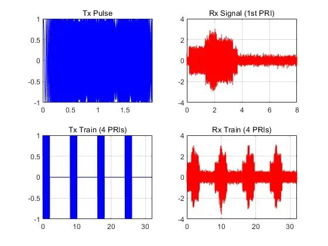
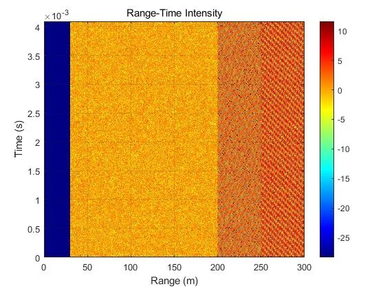
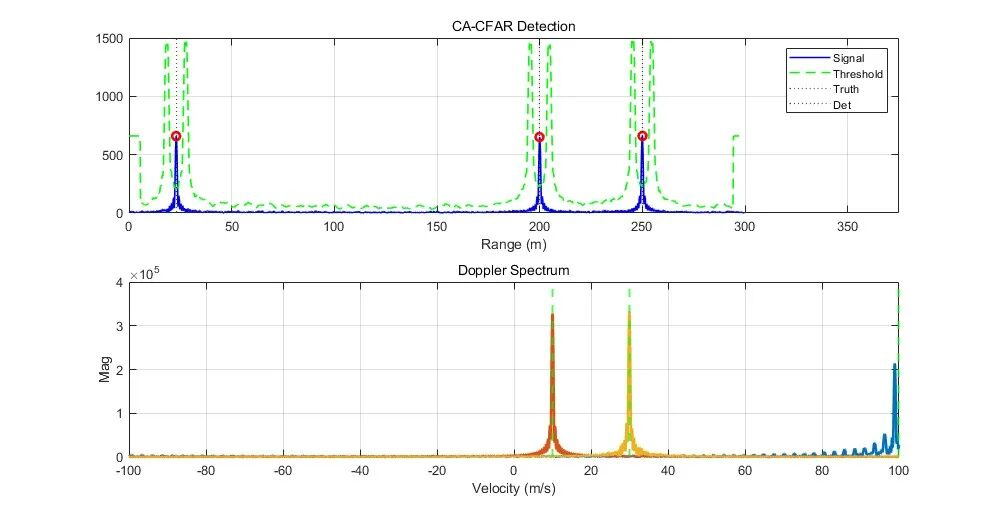
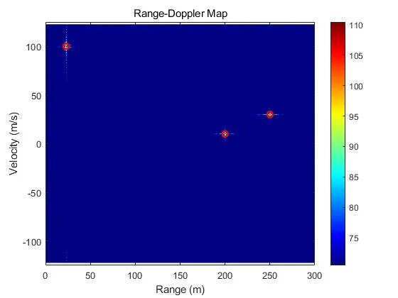

# LFM radar target distance and velocity joint estimation method based on CA-CFAR [with MATLAB code]

Personal Blog: https://www.cnblogs.com/EWFrontier
Based on CA-CFAR, an LFM radar target distance and velocity joint estimation method is proposed. In the civilian fields of intelligent transportation, security monitoring, and drone detection, radars, with their advantages of all-weather operation and anti-interference, become the core equipment for target detection and parameter estimation. Linear Frequency Modulation (LFM) radar, with its large time-bandwidth product, can simultaneously achieve high range resolution and high measurement speed accuracy. The unit average constant false alarm (CA-CFAR) detection algorithm can maintain the false alarm probability in complex noise environments, and the combination of the two provides a reliable solution for joint distance-velocity estimation in multi-target scenarios. This paper systematically expounds the theoretical system and simulation implementation effect of this method from signal modeling, core processing process to performance verification.
I. LFM Radar Signal Modeling (Part 1) Transmitted Signal Model
Among them, is the carrier frequency, is the modulation slope, is the signal bandwidth, is the pulse duration. This signal achieves decoupling of time-bandwidth through linear frequency modulation, laying the foundation for subsequent separation estimation of distance and speed.
(II) Target Backscatter Signal Model: When radar illuminates a moving target, the backscatter signal is subjected to both range dispersion and Doppler shift. Set the initial distance to, and the motion velocity to. Then, under any slow time, the instantaneous target distance is, and the corresponding echo signal delay is (assuming the propagation speed of electromagnetic waves).
At the same time, the Doppler shift caused by the target motion is (for carrier wavelength), so the complex baseband model of the echo signal is:
Among them, for the amplitude of echo signal, and is complex Gaussian white noise, corresponding to thermal noise and environmental noise in radar receiving link.
II. Core Processing Flow Theory (I) Distance Dimension Processing: Frequency Tuning and CA-CFAR Detection 1
Frequency modulation processing: Conjugately multiply the transmitted signal with the received echo signal to extract the difference frequency, i.e., The operation converts the high-frequency carrier signal into a low-frequency difference frequency signal, effectively reducing the computational complexity of subsequent signal processing. The frequency of the difference frequency signal is linearly related to the target distance.
2  
Distance FFT Transform: Conduct a Fast Fourier Transform (FFT) on the de-modulated signal, and enhance distance resolution through zero-padding operations. This process converts the signal from time domain to distance frequency domain, achieving a rough estimate of target distance.
3  
CA-CFAR detection: To detect targets stably in an unknown noise environment, the CA-CFAR algorithm is employed for threshold decision. This algorithm estimates the background noise power by training units symmetrically distributed on both sides of the target, introduces protection units to avoid interference from sidelobes of the target on the noise estimation, and the detection threshold is set as follows:
Among them, is the estimated noise power for training units, is the threshold factor, is the total number of training units, and is the preset false alarm probability. When the signal amplitude exceeds the threshold, it is determined that the target exists and the precise detection of the distance to the target is achieved.
(II) Doppler Vibration Processing and Distance-Doppler Joint Estimation
Doppler FFT Transformation: For the detected target distance gate in the distance dimension, extract the corresponding slow time-domain signal sequence. By FFT transformation, the signal is converted to the Doppler domain. Utilizing the linear mapping relationship between Doppler frequency and target velocity, the target velocity estimation is achieved.
2  
Range-Doppler Profile (RDM): A two-dimensional Fast Fourier Transform (FFT) is applied to the two-dimensional signal matrix of range-time, generating a Range-Doppler Profile. This profile visually presents the distribution of target distance and velocity in a two-dimensional plane, with each target represented by a bright spot on the profile. The x-axis represents the target's distance, and the y-axis represents its velocity, achieving joint parameter estimation for multiple targets.
3. Simulation Performance Verification (I)
Simulation parameters are set to validate the effectiveness of the verification method, including radar core parameters: Carrier frequency 76.5GHz, signal bandwidth 1GHz, pulse repetition frequency 125kHz, sampling frequency 2GHz, target number 3, Signal-to-Noise Ratio (SNR) 10dB, CFAR algorithm training units 20, protection units 30, false alarm probability 10⁻³.
(II) Results Analysis
1. Range detection performance: The CA-CFAR algorithm effectively suppresses background noise interference, with target range detection errors less than 1m, a miss rate of 0, and a false alarm rate that meets the preset indicators, verifying the reliability of range detection.
2. Speed estimation performance: Multi-Doppler FFT transformation achieves precise estimation of target speed, with speed errors less than 2m/s, accurately distinguishing between approaching and receding target motion states.
3. Visualization performance: Range-Time Intensity (RTI) plots can clearly display the movement trajectory of targets, and range-Doppler plots can intuitively differentiate the distance and velocity differences among multiple targets, providing reliable support for subsequent target tracking.
4. Conclusion
The LFM radar target range and speed joint estimation method based on CA-CFAR achieves high-precision detection and parameter estimation in complex noise environments through reasonable signal modeling and hierarchical processing. This method is both theoretically rigorous and practically applicable, not only applicable to civil radar systems but also expandable to mobile detection platforms such as airborne and ground vehicles, providing important technical support for the upgrade of intelligent perception systems. Future optimization of the CFAR algorithm structure and two-dimensional FFT resolution can further improve detection performance and multi-target discrimination capabilities under low SNR scenarios.

## Images

<!-- PAYMENT_BLOCK -->

## Get this dataset

- Payment link (Stripe): [Buy now](https://buy.stripe.com/3cs8yP7sY87d0vu9AB)
- Payment QR code: 

<!-- /PAYMENT_BLOCK -->
